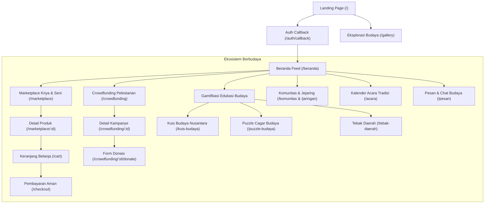

# Berbudaya (BudayaGo) UI/UX Design System & Architecture

## 1. Tautan Proyek Desain
- **Figma Master Project (Flow & Prototype)**: [Berbudaya - Full App Flow & Prototype](https://www.figma.com/design/Du1CJFUUhiRqC347AwEZvX) (File Key: `Du1CJFUUhiRqC347AwEZvX`)
- **Figma Design System & Components**: [Berbudaya UIUX Redesign System](https://www.figma.com/design/dLq19zRHpGSJZB7JNeRcUO)
- **Status Integrasi**: Terkoneksi via Figma MCP (Robin Syaifuddin)
- **Aturan Pengerjaan**: Mengacu pada skill `figma-single-project-flow` — seluruh iterasi, variasi layar, dan alur demo prototype Berbudaya wajib diperbarui langsung di dalam file master di atas tanpa membuat file baru.

---

## 2. Struktur Peta Situs & Koneksi Halaman (User Flow)

---

## 3. Prinsip Desain Anti-Slop UI & Standar Responsif

### A. Palet Warna Harmonis & Muted Neutrals (60-30-10)
- **Background / Surface (60%)**: 
  - Light mode: Pure `#FFFFFF` dengan layered surface `#F8FAFC` (Slate 50) & `#F1F5F9` (Slate 100).
  - Dark mode: `#090D16` / `#0F172A` (Slate 900) dengan surface `#1E293B`.
- **Secondary Structure (30%)**:
  - Muted borders: `rgba(15, 23, 42, 0.08)` / dark `rgba(255, 255, 255, 0.08)`.
  - Typography: Primary `#0F172A` (Slate 900), Secondary `#64748B` (Slate 500).
- **Aksen Khas Nusantara Terkurasi (10%)**:
  - Terracotta Earth: `#C2410C` (Warm Amber/Rust Nusantara).
  - Deep Heritage Emerald: `#047857` (Hijau Daun Tradisi).
  - *Dilarang keras menggunakan gradien ungu AI / neon sembarangan.*

### B. Tipografi & Layout
- **Font**: Inter / Plus Jakarta Sans dengan tracking bersih (`tracking-tight` pada heading).
- **Layout**: Hairline border 1px taktil, asimetris bento grid 70/30 atau 60/40.
- **Micro-Interactions**: Transisi halus 150ms-200ms `cubic-bezier(0.16, 1, 0.3, 1)`, feedback taktil `active:scale-[0.98]`.
- **Responsif**:
  - Mobile (360px–480px): Single-column bento, bottom navigation bar taktil, touch target minimal 44px.
  - Tablet (768px–1024px): Collapsible icon rail sidebar, 2-column feed.
  - Desktop (>1024px): Full 3-column layout (Left Navigation, Central Dynamic Feed, Right Contextual Widget).
