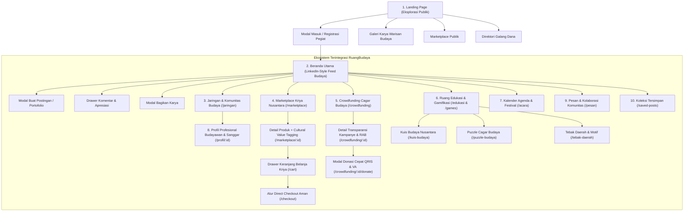
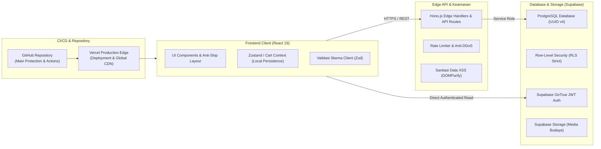
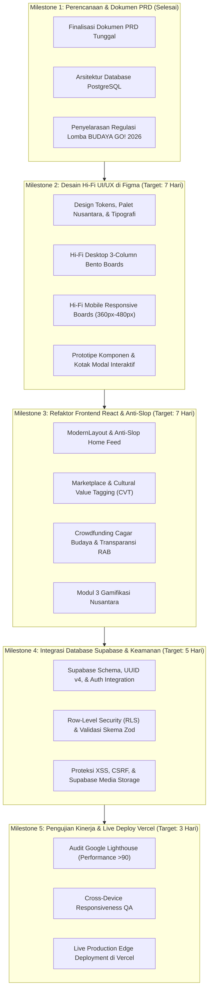

# PRODUCT REQUIREMENTS DOCUMENT (PRD)
## RUANG BUDAYA: PLATFORM JEJARING SOSIAL, EDUKASI, DAN EKONOMI DIGITAL PEMAJUAN KEBUDAYAAN INDONESIA
*(The Professional & Creative Cultural Network of Indonesia — "LinkedIn Khusus Komunitas & Pegiat Budaya Nusantara")*  
**Dokumen Induk Resmi — Acuan Desain UI/UX, Arsitektur Sistem, Keamanan, & Implementasi Produksi (Vercel + GitHub + Supabase)**  
*Diselaraskan Penuh dengan Proposal Resmi BUDAYA GO! 2026 (Kompetisi Inovasi Budaya Indonesia)*

---

## 1. Executive Summary & Visi Produk

### 1.1 Identitas Resmi & Konteks Proposal
- **Nama Resmi Produk**: **RUANG BUDAYA: Platform Jejaring Sosial, Edukasi, dan Ekonomi Digital untuk Pemajuan Kebudayaan Indonesia**
- **Ajang Kompetisi**: BUDAYA GO! 2026
- **Tema Utama**: *Indonesia Cultural Power*
- **Subtema Pilihan**: *Inventing the Future from Indonesian Culture (Promosi dan Kreasi Ekonomi Kebudayaan)*
- **Kategori**: Inovasi Digital (Web Application & Responsive Progressive Web Application - PWA)
- **Susunan Tim Pengembang (Sesuai Persyaratan Resmi 3 Anggota)**:
  1. **Anggota 1: Pengembangan Produk Digital & Purwarupa (Lead Product & Tech Engineering)**
     - *Peran & Tanggung Jawab*: Memimpin arsitektur teknis platform, rekayasa frontend & backend, UI/UX engineering, perancangan purwarupa interaktif, integrasi cloud database, serta memastikan implementasi zero-lag dan kepatuhan standar desain modern.
  2. **Anggota 2: Konteks Ekonomi & Monetisasi Berkelanjutan (Economic & Business Model Strategist)**
     - *Peran & Tanggung Jawab*: Merancang tata kelola ekosistem ekonomi digital, skema komersialisasi beretika budaya (Sustainable Culture-Driven Business Model), model transaksi adil marketplace kriya UMKM, alur direct checkout, serta transparansi platform fee crowdfunding pelestarian.
  3. **Anggota 3: Substansi Kebudayaan & Riset Warisan Tradisi (Cultural Substance & Heritage Specialist)**
     - *Peran & Tanggung Jawab*: Memastikan seluruh kurasi konten dan fitur selaras dengan 10 Objek Pemajuan Kebudayaan (UU No. 5 Tahun 2017), menjaga penghormatan hak komunal adat (TKCE), memverifikasi keabsahan data cagar budaya, serta merumuskan metadata Cultural Value Tagging (CVT) dan materi gamifikasi edukasi tradisi.

### 1.2 Visi & Nilai Inti Platform ("LinkedIn Khusus Komunitas Budaya")
Ruang Budaya memosisikan diri sebagai **Jejaring Sosial-Kreatif-Profesional Kebudayaan Indonesia Terpadu**:
Sebagaimana LinkedIn menghubungkan para profesional korporat di seluruh dunia, Ruang Budaya menjadi ruang kredibel tempat maestro seni tradisi, pengrajin kriya lokal, akademisi budaya, pengelola sanggar, komunitas adat, serta generasi muda (Gen Z & Milenial) saling:
1. **Membangun Portofolio Budaya Terverifikasi**: Memamerkan rekam jejak karya, sertifikasi tradisi, dan keahlian seni langka.
2. **Berjejaring & Berkolaborasi (Networking)**: Menghubungkan sanggar seni dengan kurator pameran, event organizer, atau sponsor CSR.
3. **Mendorong Transaksi Adil Beretika (Fair-Trade E-Commerce)**: Menjual kriya langsung dari tangan pertama tanpa perantara tengkulak melalui narasi filosofis (*Cultural Value Tagging*).
4. **Mendanai Restorasi Cagar Budaya (Transparent Crowdfunding)**: Membuka pendanaan gotong royong terverifikasi dengan rincian milestone dan transparansi anggaran material restorasi.
5. **Mentransformasi Literasi Generasi Muda**: Menghadirkan gamifikasi edukatif (Kuis, Puzzle Candi, Tebak Daerah) yang seru, adaptif, dan adiktif positif.

### 1.3 Landasan Yuridis & Nilai Tradisi (UU No. 5 Tahun 2017)
Platform dibangun berlandaskan **10 Objek Pemajuan Kebudayaan (OPK)**:
*Tradisi Lisan, Manuskrip, Adat Istiadat, Ritus, Pengetahuan Tradisional, Teknologi Tradisional, Seni, Bahasa, Permainan Rakyat, Olahraga Tradisional, serta Cagar Budaya*. Platform mematuhi prinsip **Traditional Knowledge and Cultural Expressions (TKCE)**, menjamin kepemilikan hak komunal adat, dan atribusi penuh kepada pencipta atau maestro pemilik tradisi.

---

## 2. Filosofi Desain: Anti-Slop UI & High-Taste Cultural Aesthetics

Platform Ruang Budaya menolak keras segala bentuk desain generik ala AI ("AI Slop"), template murah, atau ornamen visual membingungkan. Desain dirancang mengacu pada standar visual kelas dunia (Stripe, Linear, dan LinkedIn Modern) yang dipadukan dengan jiwa estetika Nusantara:

### 2.1 Aturan Emas Anti-Slop UI
- **Dilarang Keras Gradien Neon / AI Purple**: Menghapus gradien ungu-pink murahan dan efek glow berlebihan.
- **Dilarang Blob/Shape Melayang di Belakang Teks**: Teks harus berdiri murni (*pure typography*) di atas kanvas/surface yang bersih.
- **Dilarang Ikon Emoji pada Heading/Navigasi/Tombol**: Seluruh icon wajib menggunakan icon vektor SVG modern (Lucide Icons) dengan stroke tipis konsisten (1.5px / 1.75px).
- **Dilarang Kartu 3-Kolom Kaku Seragam**: Menerapkan proporsi asimetris bento grid (60/40 atau 70/30) dengan hierarki visual yang jelas.
- **Hairline Border 1px Taktil**: Pengganti drop shadow kabur; gunakan separator garis tipis taktil (`border-slate-200` pada tema terang, `border-white/[0.08]` pada tema gelap).

### 2.2 Palet Warna Harmonis & Selaras (Aturan 60-30-10)
Warna diambil dari pigmen alam Nusantara (tanah liat candi, getah secang, daun sirih, dan batu andesit):
- **60% — Canvas & Surface Murni**:
  - *Base Canvas*: Pure `#FFFFFF` (Light) / `#0A0E17` (Deep Slate Charcoal Dark).
  - *Layered Surface*: `#F8FAFC` (Slate 50) & `#F1F5F9` (Slate 100).
- **30% — Struktur, Hairline, & Tipografi Taktil**:
  - *Hairline Borders*: `rgba(15, 23, 42, 0.08)` / `rgba(255, 255, 255, 0.08)`.
  - *Primary Headings*: Deep Obsidian Slate `#0F172A` (Slate 900) dengan `tracking-tight` (-0.02em).
  - *Secondary Body Text*: Muted Slate `#475569` (Slate 600) untuk keterbacaan optimal tanpa silau.
- **10% — Aksen Terkurasi Budaya Nusantara**:
  - *Terracotta Earth (Kriya & Kehangatan Tradisi)*: `#C2410C` (Warm Rust / Amber-700).
  - *Deep Heritage Emerald (Pelestarian & Cagar Budaya)*: `#047857` (Emerald-700).
  - *Heritage Ochre Gold (Akreditasi & Prestasi Maestro)*: `#B45309` (Amber-600).

### 2.3 Tipografi & Purposeful Motion
- **Font Stack**: **Plus Jakarta Sans** (Heading & UI Navigasi) dipadukan dengan **Inter** (Body text & Data tabular).
- **Micro-Interactions**: Durasi transisi 150ms–200ms dengan fisika easing natural (`cubic-bezier(0.16, 1, 0.3, 1)`).
- **Tactile Feedback**: Tombol dan kartu interaktif memiliki respon sentuhan nyata (`active:scale-[0.98]` dan `hover:-translate-y-0.5`).

---

## 3. Peta Koneksi Antar-Halaman & Arsitektur Alur Pengguna (User Flow)

---

## 4. Rincian Spesifikasi Mendalam Setiap Halaman, Komponen, & Tombol

---

### 4.1 Halaman 1: Landing Page (`Landing.tsx`)
- **Fungsi Utama**: Etalase utama publik, memperkenalkan 4 pilar Ruang Budaya, menampilkan karya kurasi terbaik, serta mengajak maestro, perajin, dan anak muda bergabung.
- **Koneksi Halaman**:
  - Menghubungkan ke `AuthModal` (Masuk / Daftar).
  - Menghubungkan ke `Gallery.tsx` (Eksplorasi Galeri Publik).
  - Menghubungkan langsung ke pratinjau `Marketplace.tsx`, `Crowdfunding.tsx`, dan `Acara.tsx`.
- **Elemen & Komponen**:
  1. **Sticky Glassmorphism Top Navigation Bar**:
     - *Monogram Logo*: "RB" (Ruang Budaya) dengan hairline border taktil.
     - *Nav Links*: "Tentang Ruang Budaya", "4 Pilar", "Galeri Warisan", "Pasar Kriya", "Galang Dana", "Agenda Tradisi".
     - *Action Buttons*:
       - Tombol `Masuk` (Secondary button: hairline border, text slate-700).
       - Tombol `Gabung Komunitas` (Primary button: solid slate-900, text white, hover ring).
  2. **Hero Section (Bento Asimetris 60/40)**:
     - *Sisi Kiri (60%)*:
       - Micro-Pill Tag: *"Platform Digital Pemajuan Kebudayaan Indonesia — BUDAYA GO! 2026"*.
       - Headline Utama: *"Jejaring Profesional, Edukasi, dan Ekonomi Digital untuk Pemajuan Kebudayaan Indonesia"*.
       - Sub-headline: Penjelasan mengenai 10 Objek Pemajuan Kebudayaan, proteksi karya adat, dan ruang temu maestro dengan generasi penerus.
       - CTA Bar: Tombol utama `Mulai Eksplorasi Budaya`, tombol sekunder `Pelajari 4 Pilar`.
       - Social Proof Strip: 120+ Sanggar Terakreditasi, 45 Cagar Budaya Terbantu, 1.400+ Kriya Tersertifikasi.
     - *Sisi Kanan (40%)*:
       - Live Interactive Showcase Card: Tampilan kartu profil Maestro Tenun Ikat NTT bersanding dengan tag akreditasi resmi dan kartu kampanye restorasi Rumah Gadang secara bergantian.
  3. **Showcase 4 Pilar Terpadu**:
     - Card Pilar 1: *Jejaring Sosial Budaya* (Koneksi budayawan layaknya LinkedIn).
     - Card Pilar 2: *Marketplace Kriya Bernarasi* (Cultural Value Tagging).
     - Card Pilar 3: *Crowdfunding Pelestarian* (Transparan & Milestone-based).
     - Card Pilar 4: *Edukasi & Gamifikasi* (Kuis budaya, puzzle candi, tebak daerah).
  4. **Footer Komprehensif**:
     - Direktori cagar budaya per wilayah (Sumatera, Jawa, Bali-Nusa Tenggara, Kalimantan, Sulawesi, Maluku-Papua).
     - Atribusi hukum: UU No. 5 Tahun 2017 & TKCE.
     - Copyright & edge latency indicator.

---

### 4.2 Halaman 2: Beranda Utama Feed Komunitas (`Home.tsx` + `ModernLayout.tsx`)
- **Fungsi Utama**: Pusat aktivitas pengguna (Feed bergaya LinkedIn) tempat anggota membagikan karya, portofolio proses pembuatan kriya, liputan festival tradisi, dan diskusi budaya.
- **Koneksi Halaman**: Terhubung ke seluruh sub-modul melalui sidebar navigasi kiri dan widget kontekstual kanan.
- **Tata Letak Asimetris 3-Kolom**:
  1. **Kolom Kiri (Sidebar Navigasi & Mini Profile — Lebar 280px)**:
     - *Personal Profile Card*: Foto avatar, nama pengguna, lencana peran (`Maestro Seni` / `Pengrajin Kriya` / `Relawan Budaya`), lokasi daerah, jumlah koneksi, tombol `Lihat Profil Saya`.
     - *Vertical Navigation Menu*:
       - Tombol `Feed Kebudayaan` (Status aktif).
       - Tombol `Jaringan Budayawan` (Dengan badge angka saran koneksi).
       - Tombol `Pasar Kriya` (Ikon keranjang).
       - Tombol `Galang Dana Pelestarian` (Ikon uluran tangan).
       - Tombol `Arena Permainan` (Ikon joystick/target).
       - Tombol `Agenda Kegiatan` (Ikon kalender).
       - Tombol `Pesan & Diskusi` (Ikon chat dengan unread indicator).
       - Tombol `Koleksi Tersimpan` (Ikon bookmark).
     - *Island Filter Daerah*: Pilihan instan filter konten feed berdasarkan pulau (Jawa, Sumatera, Bali & NT, Kalimantan, Sulawesi, Maluku & Papua).
  2. **Kolom Tengah (Stream Feed Utama — Lebar Fleksibel 640px)**:
     - *Post Composer Box (`PostComposer.tsx`)*:
       - Input pemicu: *"Bagikan cerita pelestarian, progres karya kriya, atau kabar sanggarmu..."*
       - Quick Action Media: Tombol `📷 Foto Dokumentasi`, `🎥 Video Tradisi`, `📜 Naskah/Cerita`, `🏷️ Tag Kategori OPK`.
       - Tombol Primer: `Publikasikan Cerita` (Membuka atau mengirim langsung postingan).
     - *Post Card Component (`PostCard.tsx`)*:
       - Header: Avatar pembuat postingan, nama lengkap, lencana verifikasi daerah, waktu publikasi, tombol dropdown `•••` (Laporkan, Salin Tautan, Simpan).
       - Konten Teks: Tipografi rapi dengan pembatas line-clamp dan tombol `Lihat selengkapnya`.
       - Media Container: Foto/video beresolusi tinggi rasio natural tanpa cropping distorsi.
       - Metrik Interaksi: Indikator jumlah apresiasi (❤️), diskusi (💬), dan bagikan (🔗).
       - Action Bar: Tombol toggle `Apresiasi` (taktil feedback), tombol `Komentar` (membuka Comment Modal/Drawer), tombol `Bagikan` (Share Modal), dan tombol `Simpan Arsip`.
  3. **Kolom Kanan (Contextual Widgets & Recommendations — Lebar 320px)**:
     - *Widget Kuis Budaya Harian*: Tantangan 1 soal kilat berhadiah poin reputasi dengan tombol pilihan instan.
     - *Widget Kampanye Mendesak*: Kartu cagar budaya yang membutuhkan gotong royong mendesak lengkap dengan persentase progress bar.
     - *Widget Rekomendasi Budayawan*: Daftar maestro/sanggar yang relevan untuk diikuti lengkap dengan tombol `+ Ikuti`.

---

### 4.3 Halaman 3: Jaringan & Komunitas Budaya (`Jaringan.tsx` & `Komunitas.tsx`)
- **Fungsi Utama**: Halaman jaringan profesional mirip menu "My Network" pada LinkedIn untuk memperluas relasi antar pegiat budaya.
- **Koneksi Halaman**: Terhubung ke halaman `UserProfile.tsx` dan `Pesan.tsx`.
- **Elemen & Komponen**:
  - Tab Pengelompokan: `Semua Budayawan`, `Maestro & Pengrajin`, `Sanggar & Komunitas Seni`, `Akademisi & Peneliti`.
  - Filter Wilayah: Provinsi dan Kabupaten/Kota.
  - User Connection Card Grid:
    - Foto sampul kecil motif tradisi daerah + avatar.
    - Nama lengkap & gelar tradisi.
    - Kategori Objek Pemajuan Budaya yang ditekuni.
    - Asal sanggar / daerah.
    - Jumlah koneksi bersama (*mutual connections*).
    - Tombol Aksi: Tombol `+ Hubungkan / Ikuti` dan tombol `Kirim Pesan`.

---

### 4.4 Halaman 4: Marketplace Kriya Budaya & E-Commerce Flow (`Marketplace.tsx`, `ProductDetail.tsx`, `Cart.tsx`, `CheckoutPage.tsx`)
- **Fungsi Utama**: Platform transaksi kriya asli yang memberdayakan pengrajin daerah dengan diferensiasi filosofis tinggi.
- **Fitur Kunci: Cultural Value Tagging (CVT)**:
  Setiap produk wajib memiliki 4 blok metadata otentik:
  1. **Asal Daerah & Suku**: Asal mula karya dibuat.
  2. **Makna Filosofis Motif**: Cerita dan doa yang terkandung di balik motif/ukiran.
  3. **Bahan Alami & Teknik Pembuatan**: Pengerjaan tangan (*hand-woven / hand-carved*) dan pewarna alami.
  4. **Profil Pengrajin Mitra**: Cerita sosok pembuat untuk menjaga transparansi dan keadilan ekonomi.
- **Komponen Halaman**:
  - *Header Pencarian & Filter Cerdas*: Kolom cari kriya, filter kategori (Kain Tradisional, Kriya Kayu & Batu, Wayang & Topeng, Perhiasan Tradisi, Kuliner Awetan Tradisi), dan filter provinsi.
  - *Product Card Grid*: Foto produk rasio 4:3, tag daerah, judul kriya, harga transparan (Rp), nama sanggar perajin, tombol `Lihat Detail`, dan tombol cepat `+ Keranjang`.
  - *Drawer Keranjang Belanja (`CartContext.tsx`)*: Panel geser kanan berisi daftar kriya, counter jumlah barang (+/-), catatan khusus ukuran, kalkulasi subtotal, dan tombol CTA `Lanjut ke Pembayaran (/checkout)`.
  - *Halaman Direct Checkout (`CheckoutPage.tsx`)*: Form alamat kirim ke pelosok Indonesia, opsi logistik (JNE, SiCepat, Pos Indonesia), ringkasan biaya tanpa biaya tersembunyi, opsi pembayaran instan (QRIS / Bank Virtual Account / Kartu), dan tombol final `Bayar Pesanan Sekarang`.

---

### 4.5 Halaman 5: Crowdfunding Khusus Pelestarian Budaya (`Crowdfunding.tsx`, `CrowdfundingDetail.tsx`, `CrowdfundingDonate.tsx`)
- **Fungsi Utama**: Wadah gotong royong terpercaya khusus penyelamatan cagar budaya, restorasi rumah adat, pelestarian manuskrip kuno, dan regenerasi kesenian langka.
- **Komponen Halaman**:
  - *Direktori Kampanye*: Filter kategori (Arsitektur Adat, Manuskrip Kuno, Kesenian Langka, Cagar Budaya Fisik).
  - *Kartu Kampanye*: Foto cagar budaya, badge verifikasi kurator resmi, sisa hari, nama inisiator, progress bar donasi, jumlah donatur, dan tombol `Donasi Sekarang`.
  - *Halaman Detail Kampanye (`CrowdfundingDetail.tsx`)*:
    - Tab 1: **Kisah & Urgensi**: Latar belakang sejarah dan kondisi kerusakan fisik.
    - Tab 2: **Transparansi RAB**: Rincian anggaran biaya terbuka (material kayu andalas, atap ijuk, upah tukang ukir tradisional).
    - Tab 3: **Log Perkembangan (Milestone Update)**: Laporan kemajuan fisik berkala beserta foto lapangan.
    - Tab 4: **Daftar Donatur & Doa**: Komentar dukungan dari masyarakat.
  - *Modal Donasi Instan (`CrowdfundingDonate.tsx`)*:
    - Pilihan nominal cepat: Rp 25.000, Rp 50.000, Rp 100.000, Rp 250.000, Rp 500.000, atau input nominal bebas.
    - Opsi anonim (*Hamba Allah / Donatur Anonim*).
    - Input doa dan penyemangat bagi masyarakat adat.
    - Metode pembayaran QRIS instan dan Bank VA.
    - Tombol aksi `Selesaikan Donasi Budaya`.

---

### 4.6 Halaman 6: Ruang Edukasi & Tiga Gamifikasi Budaya (`Edukasi.tsx`, `KuisBudayaPage.tsx`, `PuzzleBudayaPage.tsx`, `TebakDaerahPage.tsx`)
- **Fungsi Utama**: Sarana edukasi interaktif agar generasi Z dan masyarakat luas tertarik mempelajari khazanah budaya dengan cara yang menyenangkan dan kompetitif.
- **Tiga Permainan Nusantara**:
  1. **Kuis Budaya Nusantara (`KuisBudaya.tsx`)**:
     - Pilihan ganda 4 opsi pertanyaan seputar 10 Objek Pemajuan Budaya.
     - Timer hitung mundur 15 detik per soal.
     - Visual taktil umpan balik: Hijau untuk jawaban benar, Merah untuk salah.
     - Kotak edukasi sejarah di balik jawaban yang benar.
     - Leaderboard skor nasional mingguan.
  2. **Puzzle Candi & Cagar Budaya (`PuzzleBudaya.tsx`)**:
     - Game rekonstruksi kepingan visual relief candi atau motif tenun dalam grid 3x3.
     - Counter jumlah gerakan (*moves*) dan pencatat waktu.
     - Tombol `Lihat Gambar Asli` dan `Acak Ulang Kepingan`.
  3. **Tebak Daerah & Motif (`TebakDaerah.tsx`)**:
     - Menampilkan siluet visual pusaka adat, rumah adat, atau motif batik.
     - Input tebakan teks atau pilihan opsi provinsi dengan sistem 3 kesempatan nyawa.
- **Direktori Kursus & Lokakarya Tradisi**: Jadwal workshop langsung belajar menenun, membatik, atau memainkan gamelan bersama maestro.

---

### 4.7 Halaman 7: Kalender Agenda & Festival Tradisi (`Acara.tsx`)
- **Fungsi Utama**: Direktori terpusat agenda festival kebudayaan, upacara adat, pawai seni, dan pameran kriya di seluruh Indonesia.
- **Komponen Halaman**:
  - Filter Tampilan: Kalender Bulanan atau Tampilan Daftar (*List View*).
  - Filter Acara: Berdasarkan Tanggal, Provinsi, Gratis / Tiket Berbayar, serta Format (Hadir Fisik / Live Streaming).
  - Event Card: Foto banner, tanggal pelaksanaan, lokasi spesifik (desa adat/alun-alun/gedung pertunjukan), deskripsi tata krama busana adat bagi pengunjung, dan kuota peserta.
  - Tombol Aksi: `Tambahkan ke Google Calendar` dan `Reservasi / Beli Tiket Masuk`.

---

### 4.8 Halaman 8: Profil Profesional Budayawan & Sanggar (`Profil.tsx` & `UserProfile.tsx`)
- **Fungsi Utama**: Portofolio resmi dan CV digital pegiat budaya (setara profil profesional LinkedIn).
- **Komponen Halaman**:
  - *Header Profil*: Banner foto latar sanggar/cagar budaya, foto avatar terverifikasi, nama lengkap, gelar kehormatan tradisi, lokasi asal, dan lencana akreditasi lembaga adat.
  - *Bio & Rekam Jejak*: Ringkasan dedikasi, keahlian khusus OPK, serta tahun berkarya.
  - *Tabbed Portfolio Showcase*:
    - Tab 1: **Postingan & Dokumentasi**: Tulisan, rekaman suara, dan foto lapangan.
    - Tab 2: **Katalog Kriya**: Produk yang dihasilkan oleh perajin bersangkutan.
    - Tab 3: **Kampanye Pelestarian**: Rekam jejak inisiatif cagar budaya yang pernah diajukan.
    - Tab 4: **Sertifikasi & Penghargaan Tradisi**: Rekognisi dari dinas kebudayaan atau lembaga adat.
  - *Action Bar*: Tombol Primer `+ Hubungkan / Ikuti`, Tombol Sekunder `Kirim Pesan Kolaborasi`.

---

### 4.9 Halaman 9: Pesan & Kolaborasi Komunitas (`Pesan.tsx`)
- **Fungsi Utama**: Saluran komunikasi langsung antar budayawan, pembeli kriya dengan perajin, atau donatur dengan penyelenggara sanggar.
- **Komponen Halaman**:
  - Kolom Kiri: Daftar percakapan aktif, pencarian pesan, waktu pesan terakhir, dan unread badge counter.
  - Kolom Tengah: Panel obrolan terenkripsi, gelembung chat rapi, kemampuan kirim foto sampel kriya atau file dokumen tradisi.
  - Kolom Kanan: Info ringkas lawan bicara (tautan profil, status keanggotaan, ulasan reputasi perajin).

---

### 4.10 Halaman 10: Koleksi Tersimpan (`SavedPosts.tsx`)
- **Fungsi Utama**: Arsip pribadi pengguna untuk menyimpan postingan inspiratif, resep tradisi, dokumentasi kriya, atau tutorial seni.
- **Komponen Halaman**:
  - Filter Kategori Arsip: `Semua`, `Kriya & Tutorial`, `Kisah Sejarah`, `Agenda Acara`.
  - Grid kartu postingan tersimpan dengan tombol instan `Hapus dari Simpanan` atau `Bagikan`.

---

## 5. Rincian Seluruh Kotak Modal & Dialog Interaktif

Setiap modal dirancang dengan backdrop blur halus (`backdrop-blur-sm`), animasi masuk mikro (*zoom-in 95% to 100%* durasi 150ms), dan tombol tutup taktil:

| Nama Modal | File Terkait | Form, Elemen, & Konten | Tombol Aksi |
|---|---|---|---|
| **Modal Buat Postingan** | `CreatePostModal.tsx` | Dropdown 10 Objek Pemajuan Kebudayaan, input judul narasi, textarea cerita, zona drag & drop foto/video dokumenter, picker lokasi kabupaten/provinsi. | `Batal`, `Simpan Draf`, `Publikasikan Cerita` |
| **Modal Komentar** | `CommentModal.tsx` | Thread list komentar bersarang (*nested replies*), mention budayawan `@nama`, textarea respon, tombol apresiasi respon. | `Tutup`, `Kirim Respon` |
| **Modal Bagikan (Share)** | `ShareModal.tsx` | Quick share icons (WhatsApp, X/Twitter, Facebook, LinkedIn), field link URL lengkap dengan tombol salin taktil berstatus (*Tersalin!*). | `Salin Tautan`, `Tutup` |
| **Modal Keranjang Belanja** | `CartContext.tsx` | List item kriya terpilih, tombol counter kuantitas (+/-), input catatan khusus pengrajin, kalkulasi subtotal dinamis. | `Lanjut Belanja`, `Checkout Sekarang` |
| **Modal Donasi Cepat** | `CrowdfundingDonate.tsx` | Chip pilihan nominal instan (Rp 25k, 50k, 100k, 250k, 500k), input nominal bebas, toggle anonim (*Hamba Allah*), pilihan QRIS/VA. | `Batal`, `Konfirmasi Donasi` |
| **Modal Autentikasi / Masuk** | `AuthCallbackPage.tsx` | Pilihan login satu klik Google OAuth, form email & sandi, form registrasi nama lengkap, pemilihan asal daerah dan minat budaya. | `Masuk`, `Daftar Baru`, `Lupa Sandi` |

---

## 6. Arsitektur Kode, Keamanan, Integritas, & Infrastruktur (Vercel + GitHub + Supabase)

Arsitektur sistem dibangun dengan standar **Clean Architecture**, keamanan enterprise tingkat tinggi, zero-lag, dan latensi ultra-rendah:

### 6.1 Frontend Architecture (React 19, TypeScript, Tailwind CSS, Vite)
- **Framework & Bundler**: React 19 dengan Vite bundler untuk *Hot Module Replacement (HMR)* instan dan build bundle teroptimasi di bawah 150KB (Gzip).
- **Manajemen State**:
  - `CartContext.tsx` untuk state keranjang belanja persisten (tersimpan di `localStorage` terenkripsi ringan).
  - React Query / SWR untuk data caching, background revalidation, dan zero-loading flash.
- **Iconography**: `lucide-react` (100% vektor modern seragam).

### 6.2 Hosting & CI/CD Pipeline (GitHub + Vercel)
- **GitHub Repository Management**:
  - `main` branch diproteksi (*branch protection rules*) dari direct commit.
  - Workflow GitHub Actions otomatis menjalankan linting (`eslint`), verifikasi tipe (`tsc --noEmit`), dan audit keamanan dependensi sebelum merge.
- **Vercel Edge Network Deployment**:
  - Deployment global otomatis pada setiap push ke `main`.
  - Routing diatur melalui `vercel.json` dengan caching header agresif untuk aset statis (`Cache-Control: public, max-age=31536000, immutable`).
  - Halaman SPA disalurkan dengan fallback rewrite ke `index.html` tanpa error 404 pada deep link.

### 6.3 Database & Backend (Supabase PostgreSQL + Edge Functions)
- **Supabase Authentication**:
  - Mendukung Google OAuth dan email passwordless magic-link.
  - Token JWT tersimpan di secure HTTP-only cookies atau storage terisolasi anti-XSS.
- **Skema Database Relasional PostgreSQL**:
  1. `profiles`: `id (UUID references auth.users)`, `full_name`, `avatar_url`, `bio`, `role (maestro/artisan/member/admin)`, `region`, `verified_status (boolean)`, `created_at`.
  2. `posts`: `id (UUID)`, `author_id (references profiles.id)`, `title`, `content`, `category (10 OPK enum)`, `media_urls (array text)`, `likes_count`, `comments_count`, `created_at`.
  3. `products`: `id (UUID)`, `seller_id (references profiles.id)`, `name`, `description`, `price (numeric)`, `stock (int)`, `category`, `origin_region`, `cultural_meaning (text)`, `material_technique (text)`, `image_urls (array text)`, `created_at`.
  4. `campaigns`: `id (UUID)`, `initiator_id (references profiles.id)`, `title`, `description`, `target_amount (numeric)`, `current_amount (numeric)`, `deadline (date)`, `rab_details (jsonb)`, `is_verified (boolean)`, `created_at`.
  5. `donations`: `id (UUID)`, `campaign_id (references campaigns.id)`, `donor_id (nullable for anon)`, `donor_name`, `amount (numeric)`, `message (text)`, `payment_status (pending/success/failed)`, `created_at`.
  6. `orders`: `id (UUID)`, `buyer_id (references profiles.id)`, `total_amount (numeric)`, `shipping_address (jsonb)`, `order_status (pending/paid/shipped/delivered)`, `created_at`.

### 6.4 Keamanan, Integritas, & Proteksi Data (Zero Bug & Lag)
1. **Row-Level Security (RLS) PostgreSQL**:
   - Setiap tabel di Supabase dikunci dengan kebijakan RLS ketat.
   - Pengguna hanya memiliki hak mutasi (`UPDATE`, `DELETE`) pada data miliknya sendiri (`auth.uid() = author_id`).
   - Admin dan kurator memiliki policy tersendiri untuk verifikasi kampanye donasi dan keaslian produk kriya.
2. **Validasi Skema Berlapis (Zod)**:
   - Validasi data input form di sisi frontend sebelum pengiriman data.
   - Re-validasi di edge endpoint untuk mencegah injeksi payload jahat (*Zero Trust*).
3. **Pemberantasan XSS & Sanitasi HTML**:
   - Seluruh konten narasi budaya dan komentar disanitasi menggunakan DOMPurify sebelum di-render.
4. **Proteksi IDOR & CSRF**:
   - Penggunaan UUID v4 acak pada seluruh entitas (tidak menggunakan sequential ID integer) untuk mencegah pembobolan IDOR.
   - Header request diverifikasi dengan CSRF token pada setiap mutasi data sensitif.
5. **Optimasi Performa Zero-Lag (<50ms Latency)**:
   - Gambar kriya dan cagar budaya dioptimasi otomatis via Supabase Image Transform (format WebP/AVIF dengan lazy loading `loading="lazy"`).
   - Pengindeksan database (*PostgreSQL B-Tree Indexes*) pada kolom foreign keys, query search, dan timestamp.
   - Virtualisasi daftar (*virtualized scroll*) untuk feed panjang guna mencegah memory leak pada browser mobile.

---

## 7. Milestone & Roadmap Pengerjaan Proyek

Proyek dijalankan dalam 5 fase terukur:

### Rincian Target Milestone:
- **Milestone 1: Fondasi & Dokumen Spesifikasi (Selesai)**:
  Penyusunan PRD komprehensif, arsitektur database, dan penyelarasan 100% dengan Proposal BUDAYA GO! 2026.
- **Milestone 2: Desain Hi-Fi UI/UX di Figma (Target: 7 Hari Kerja)**:
  Pembuatan kanvas desain lengkap di file Figma tim (`dLq19zRHpGSJZB7JNeRcUO`): Design Token, 10 Halaman Lengkap, Varian Komponen, dan Seluruh Modal Interaktif.
- **Milestone 3: Refactoring Frontend React & Tailwind Anti-Slop (Target: 7 Hari Kerja)**:
  Implementasi tata letak bento asimetris, perbaikan tipografi, penghapusan elemen AI Slop, dan integrasi Lucide Icons pada codebase `sc ruangbudaya`.
- **Milestone 4: Integrasi Database Supabase & Keamanan RLS (Target: 5 Hari Kerja)**:
  Pemasangan skema tabel PostgreSQL, RLS policies, autentikasi sesi, serta integrasi storage gambar kriya.
- **Milestone 5: Pengujian Kinerja, Audit Keamanan, & Deploy Vercel (Target: 3 Hari Kerja)**:
  Pengujian responsiveness multi-device (iPhone, Android, Tablet, Laptop, Desktop Ultra-wide), audit Google Lighthouse (Target skor: Performance >90, Accessibility 100, Best Practices 100), dan deployment live production di Vercel.

---

## 8. Kesimpulan & Status Kesiapan Implementasi

Dokumen **PRD** ini menjadi satu-satunya pedoman tunggal (*Single Source of Truth*) yang mengikat seluruh proses desain dan pengkodean platform Ruang Budaya. Dengan standar **Anti-Slop UI**, **High Taste Design**, dan arsitektur modern **GitHub + Vercel + Supabase**, Ruang Budaya siap menjadi mahakarya inovasi digital kebudayaan yang membanggakan bagi Indonesia.
