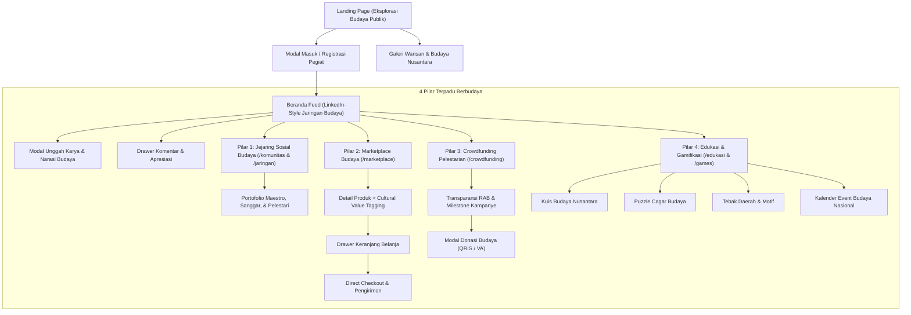

# PRODUCT REQUIREMENTS DOCUMENT (PRD) & DESIGN PLAN
## Berbudaya: PLATFORM JEJARING SOSIAL, EDUKASI, DAN EKONOMI DIGITAL UNTUK PEMAJUAN KEBUDAYAAN INDONESIA
*(The Professional & Creative Cultural Network of Indonesia — Diselaraskan 100% dengan Proposal Resmi BUDAYA GO! 2026)*

---

## 1. Executive Summary & Visi Produk (Sesuai Proposal Budaya Go! 2026)

### 1.1 Visi & Identitas Resmi
- **Nama Resmi Produk**: Berbudaya: Platform Jejaring Sosial, Edukasi, dan Ekonomi Digital untuk Pemajuan Kebudayaan Indonesia.
- **Kompetisi**: BUDAYA GO! 2026 | Subtema: *Inventing the Future from Indonesian Culture (Promosi dan Kreasi Ekonomi Kebudayaan)*.
- **Tim Pengembang**: Robin Syaifuddin (Project Manager), Muhammad Zahran Albara (Front-End & UI/UX Engineering), Karina (UI/UX Designer), Asya Rahma Zakia (Cultural Content Research), Aditya Wahyu Suhendra (Back-End & Edge Architect).
- **Visi Utama**: Menjadi ekosistem digital kebudayaan nasional nomor satu di Indonesia yang memadukan fungsi jejaring profesional sosial layaknya **LinkedIn khusus komunitas budaya**, dengan 4 pilar terintegrasi:
  1. **Jejaring Sosial Budaya** (Koneksi kreator, komunitas, sanggar seni, dan budayawan).
  2. **Marketplace Budaya & Kriya UMKM** (Dilengkapi fitur unik *Cultural Value Tagging* & *direct checkout*).
  3. **Crowdfunding Khusus Pelestarian Budaya** (Milestone-based, transparan, terverifikasi untuk cagar budaya & WBTb).
  4. **Ruang Edukasi & Gamifikasi Interaktif** (Kursus tradisi, kalender event nasional, kuis budaya, puzzle candi, dan tebak daerah).

### 1.2 Landasan Yuridis & Nilai Tradisi (Proposal Poin 6)
- **10 Objek Pemajuan Kebudayaan (UU No. 5 Tahun 2017)**: Tradisi Lisan, Manuskrip, Adat Istiadat, Ritus, Pengetahuan Tradisional, Teknologi Tradisional, Seni, Bahasa, Permainan Rakyat, Olahraga Tradisional, dan Cagar Budaya.
- **Traditional Knowledge and Cultural Expressions (TKCE)**: Menghormati hak komunal dan menjamin atribusi penuh kepada pencipta, maestro, dan komunitas adat pemilik tradisi.
- **Kesiapan Produk (TRL 7 / Working Product)**: Seluruh modul telah diuji dan berfungsi di lingkungan aktual.

---

## 2. Arsitektur Informasi & Peta Alur Pengguna (User Flow)

---

## 3. Spesifikasi Lengkap Halaman, Komponen, & Tombol

### 3.1 Landing Page (`Landing.tsx`)
- **Tujuan**: Memperkenalkan platform kepada publik, menonjolkan 4 pilar ekosistem, serta mengajak partisipasi publik dalam pemajuan kebudayaan nasional.
- **Elemen & Tombol**:
  - **Header Navigasi**: Logo Berbudaya, tautan menu (Tentang Kami, 4 Pilar Budaya, Galeri Warisan, Kriya Unggulan, Kalender Acara), tombol `Masuk`, dan tombol CTA `Gabung Komunitas`.
  - **Hero Section (Bento Asimetris 60/40)**:
    - *Sisi Kiri*: Badge `"Inovasi Resmi BUDAYA GO! 2026"`, Headline `"Jejaring Sosial, Edukasi, dan Ekonomi Digital Pemajuan Kebudayaan Indonesia"`, sub-narasi 10 Objek Pemajuan Kebudayaan, tombol CTA `Mulai Eksplorasi Sekarang` dan `Dukung Cagar Budaya`.
    - *Sisi Kanan*: Interactive Showcase Card menampilkan kartu profil Maestro Pengrajin, kain tenun bersertifikasi, dan live progress restorasi rumah adat.
  - **Bento 4 Pilar Showcase**:
    - Kartu Pilar 1: *Jejaring Sosial Budaya* (Koneksi budayawan & sanggar daerah).
    - Kartu Pilar 2: *Marketplace Bernarasi Filosofis* (Cultural Value Tagging).
    - Kartu Pilar 3: *Crowdfunding Pelestarian* (Transparansi RAB & Milestone).
    - Kartu Pilar 4: *Edukasi Imersif & Gamifikasi* (Kuis, puzzle, tebak daerah).
  - **Footer Terpadu**: Direktori cagar budaya daerah per pulau, legalitas hak cipta komunal TKCE, dan status edge runtime.

---

### 3.2 Beranda Utama / Home Feed (`Home.tsx` + `ModernLayout.tsx`)
- **Tujuan**: Feed profesional komunitas kebudayaan bergaya LinkedIn yang bersih, cepat, dan taktil.
- **Tata Letak 3-Kolom Asimetris (Anti-Slop UI)**:
  - **Kolom Kiri (Navigasi & Profil Personal - 280px)**:
    - Mini Profile Card: Foto profil, nama lengkap, lencana verifikasi (`Maestro Tradisi` / `Sanggar Seni` / `Pelestari Muda`), asal daerah, dan jumlah koneksi.
    - Rail Navigasi:
      - `Feed Kebudayaan` (Aktif)
      - `Jaringan Budayawan & Sanggar` (/jaringan)
      - `Pasar Kriya Nusantara` (/marketplace)
      - `Galang Dana Pelestarian` (/crowdfunding)
      - `Arena Permainan Budaya` (/games)
      - `Agenda Kegiatan Tradisi` (/acara)
      - `Pesan & Diskusi` (/pesan)
    - Island Filter: Filter cepat per pulau (Jawa, Sumatera, Bali & Nusa Tenggara, Kalimantan, Sulawesi, Maluku & Papua).
  - **Kolom Tengah (Main Feed Stream - Fleksibel 640px)**:
    - *Post Composer*:
      - Input placeholder: *"Bagikan cerita pelestarian, karya kriya terbaru, atau kabar sanggar..."*
      - Tombol aksi media: `📷 Foto Karya`, `🎥 Video Dokumenter`, `📜 Dokumen Tradisi`, `🏷️ Tag Komunitas`.
      - Tombol Primer: `"Publikasikan Cerita"`.
    - *Post Card*:
      - Header pengunggah: Avatar, nama, badge akreditasi daerah, timestamp, tombol `•••` (opsi aksi).
      - Teks narasi budaya dengan format tipografi bersih (hairline border 1px).
      - Media container foto/video tradisi rasio proporsional.
      - Action Bar: Tombol `Apresiasi` (❤️), tombol `Beri Komentar` (💬 membuka modal komentar), tombol `Bagikan` (🔗), dan tombol `Simpan Arsip` (🔖).
  - **Kolom Kanan (Widget Interaktif - 320px)**:
    - Widget Gamifikasi Harian: Mini-kuis budaya berhadiah poin reputasi.
    - Widget Kampanye Mendesak: Cagar budaya terancam punah dengan progress bar donasi.
    - Widget Rekomendasi Sanggar: Profil budayawan daerah yang direkomendasikan untuk diikuti (`+ Ikuti`).

---

### 3.3 Marketplace Budaya dengan "Cultural Value Tagging" (`Marketplace.tsx` & `ProductDetail.tsx`)
- **Tujuan**: Memfasilitasi UMKM kriya daerah dengan nilai tambah filosofis dan transparansi asal pengrajin.
- **Fitur Kunci Proposal**:
  - **Cultural Value Tagging (CVT)**: Setiap produk wajib memiliki 4 metadata khusus:
    1. *Asal Daerah & Suku* (misal: Sikka, Maumere - Flores).
    2. *Makna Filosofis Motif* (misal: motif Rempa melambangkan perlindungan leluhur).
    3. *Bahan Alami & Teknik Pengerjaan* (misal: pewarnaan alami akar mengkudu, tenun gedogan manual).
    4. *Profil Pengrajin / Kelompok Tenun Mitra*.
  - **Katalog & Filter**:
    - Filter berdasarkan kategori (Kain Tradisional, Kriya Kayu & Logam, Wayang & Topeng, Perhiasan Adat, Kuliner Awetan).
    - Sortir: Produk Tersertifikasi Asli, Terpopuler, Harga Terendah/Tertinggi.
  - **Keranjang & Direct Checkout (`Cart.tsx` & `CheckoutPage.tsx`)**:
    - Drawer keranjang belanja dengan ringkasan kuantitas dan catatan khusus ukuran.
    - Checkout langsung dengan kurir ke pelosok dan pembayaran QRIS/Virtual Account.

---

### 3.4 Crowdfunding Khusus Pelestarian Budaya (`Crowdfunding.tsx` & `CrowdfundingDetail.tsx`)
- **Tujuan**: Wadah galang dana gotong royong terpercaya khusus pelestarian cagar budaya dan tradisi terancam punah.
- **Fitur Kunci Proposal**:
  - **Verifikasi Tim Kurator**: Hanya kampanye yang lolos validasi keabsahan cagar budaya/WBTb yang dapat tayang.
  - **Milestone-Based & Transparansi RAB**: Detail kampanye menampilkan alokasi anggaran transparan (biaya bahan baku kayu/ijuk, upah perajin tradisional, dokumentasi).
  - **Log Pembaruan Berkala**: Laporan fisik progres restorasi di lapangan dengan foto bukti.
  - **Modal Donasi Instan (`CrowdfundingDonate.tsx`)**:
    - Pilihan nominal cepat: Rp 25.000, Rp 50.000, Rp 100.000, Rp 250.000, Rp 500.000, atau nominal bebas.
    - Opsi donatur anonim dan titip doa pelestarian.
    - Pembayaran instan via QRIS dan Virtual Account perbankan nasional.

---

### 3.5 Ruang Edukasi & Gamifikasi Interaktif (`Edukasi.tsx` & Modul Permainan)
- **Tujuan**: Penguatan literasi budaya generasi muda melalui medium digital yang adaptif dan adiktif positif.
- **Tiga Game Nusantara Terpasang**:
  1. **Kuis Budaya Nusantara (`KuisBudaya.tsx` / `KuisBudayaPage.tsx`)**:
     - Format pilihan ganda 4 opsi dengan timer 15 detik.
     - Penjelasan edukasi sejarah di balik kunci jawaban.
     - Papan peringkat (leaderboard) skor harian dan mingguan.
  2. **Puzzle Candi & Cagar Budaya (`PuzzleBudaya.tsx` / `PuzzleBudayaPage.tsx`)**:
     - Game rekonstruksi visual relief candi atau motif tenun dalam grid 3x3.
     - Fitur counter langkah gerak dan tombol bantuan preview gambar asli.
  3. **Tebak Daerah & Motif (`TebakDaerah.tsx` / `TebakDaerahPage.tsx`)**:
     - Identifikasi senjata tradisional, rumah adat, atau motif batik lewat siluet visual.
     - Pilihan provinsi atau input tebak teks dengan sistem 3 nyawa.
- **Kalender Acara & Festival (`Acara.tsx`)**:
  - Direktori upacara adat dan pementasan seni se-Indonesia.
  - Tombol sinkronisasi ke kalender pengguna dan reservasi tiket.

---

### 3.6 Profil Profesional Budayawan & Sanggar (`Profil.tsx` & `UserProfile.tsx`)
- **Tujuan**: Resume portofolio digital pegiat budaya (layaknya profil LinkedIn berstandar kebudayaan).
- **Elemen Profil**:
  - Header dengan foto latar cagar budaya, foto profil, dan badge akreditasi status (*Maestro Kriya*, *Sanggar Tradisi*, *Akademisi Budaya*).
  - Tab Portofolio:
    - *Postingan & Riset*: Dokumentasi karya tulis dan foto lapangan.
    - *Katalog Kriya*: Produk kriya yang dibuat oleh perajin bersangkutan.
    - *Riwayat Kampanye*: Program pelestarian yang telah diinisiasi/didukung.
    - *Penghargaan & Hak Kekayaan Intelektual Tradisional*.
  - Tombol Aksi: `+ Terhubung / Ikuti` dan `Kirim Pesan Kolaborasi`.

---

## 4. Seluruh Kotak Modal & Dialog Interaktif

| Nama Modal | File Terkait | Form & Konten | Tombol Aksi |
|---|---|---|---|
| **Modal Buat Postingan** | `CreatePostModal.tsx` | Dropdown 10 Objek Pemajuan Budaya, input judul narasi, textarea cerita, zona unggah foto/video dokumen tradisi, picker lokasi daerah. | `Batal`, `Simpan Draf`, `Publikasikan Cerita` |
| **Modal Komentar** | `CommentModal.tsx` | Thread percakapan komunitas, mention pengrajin `@nama`, textarea respon, tombol apresiasi. | `Tutup`, `Kirim Respon` |
| **Modal Bagikan (Share)** | `ShareModal.tsx` | Quick share icons (WhatsApp, X/Twitter, Facebook, LinkedIn), field link URL dengan tombol salin taktil. | `Salin Tautan`, `Tutup` |
| **Modal Keranjang Belanja** | `CartContext.tsx` | List item belanja kriya, counter kuantitas (+/-), catatan pengrajin, kalkulasi subtotal. | `Lanjut Belanja`, `Checkout Sekarang` |
| **Modal Donasi Cepat** | `CrowdfundingDonate.tsx` | Chip pilihan nominal (Rp 25k - 500k), input kustom, toggle anonim, metode QRIS/VA. | `Batal`, `Konfirmasi Donasi` |
| **Modal Autentikasi / Masuk** | `AuthCallbackPage.tsx` | Login via Google / Email, form registrasi nama lengkap, pemilihan daerah asal & minat budaya. | `Masuk`, `Daftar Baru`, `Lupa Sandi` |

---

## 5. Standar Visual & Desain Anti-Slop UI (Sesuai Proposal)

- **Fondasi Tipografi**: Inter / Plus Jakarta Sans dengan `tracking-tight` pada headline, sans serif murni tanpa efek gradient teks berlebihan.
- **Palet 60-30-10 Berakar Nusantara**:
  - *Dominan 60%*: Slate White (`#FFFFFF`) dan Surface Layer Slate 50/100 (`#F8FAFC`).
  - *Struktur 30%*: Muted Hairline Border 1px (`rgba(15, 23, 42, 0.08)`), Slate Typography 900/600.
  - *Aksen Tradisi 10%*: **Terracotta Rust** (`#C2410C` untuk sentuhan tanah liat/batik) & **Deep Heritage Emerald** (`#047857` untuk pelestarian alam & cagar budaya).
- **Responsive Adaptability**:
  - *Mobile (360px–480px)*: Single-column flow, touch target minimal 44px, bottom app bar taktil.
  - *Desktop (>1024px)*: 3-column bento layout dengan sticky navigation rail.
