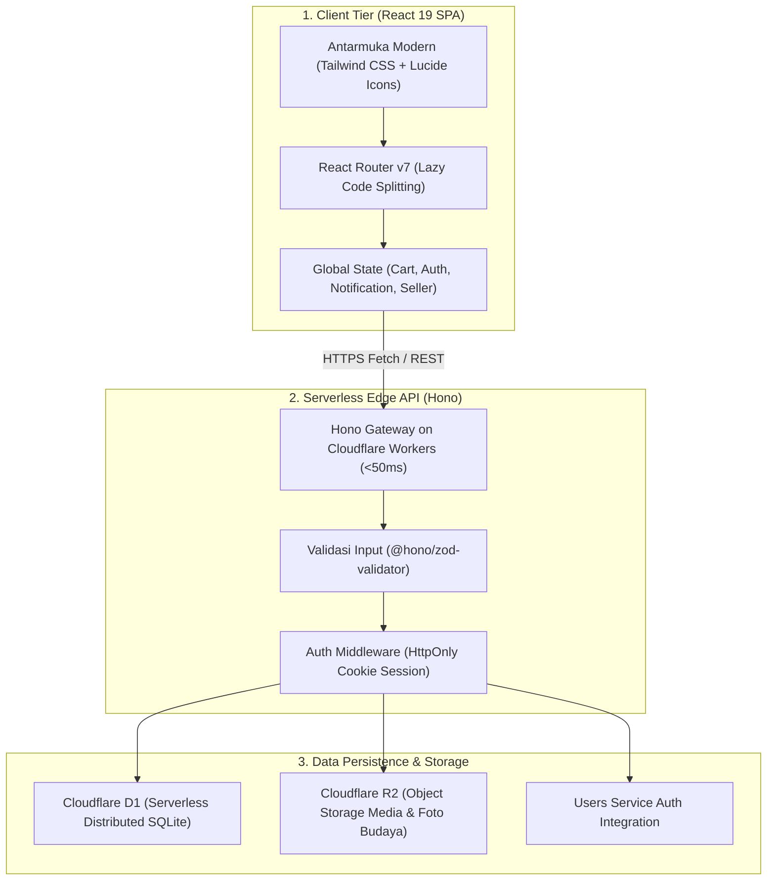
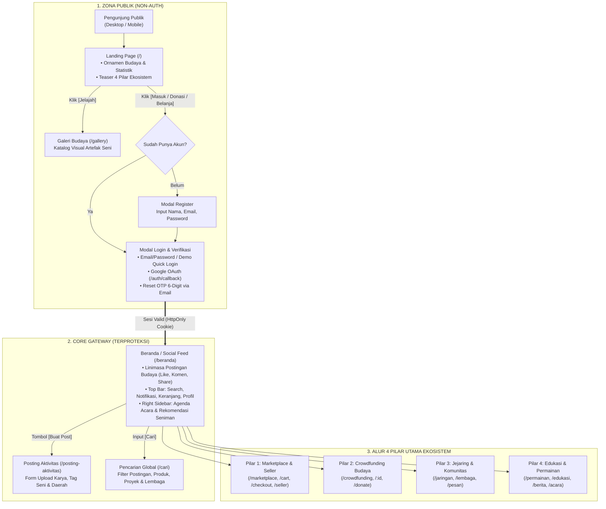
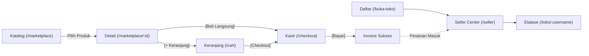
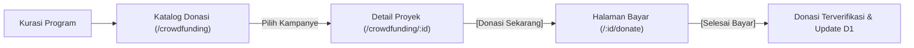
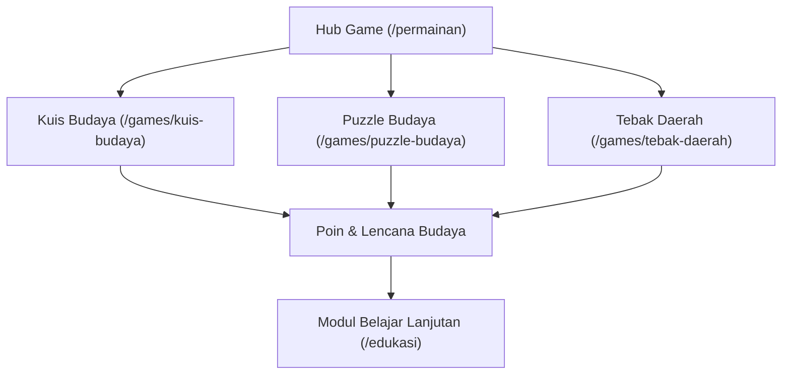

# Product Knowledge & Bedah Arsitektur: Berbudaya.id (Ruang Budaya)

> Dokumen komprehensif product knowledge, alur navigasi pengguna (user flow), mekanisme kerja sistem, serta katalog fungsional seluruh halaman web dari landing page hingga fitur transaksi dan interaktif.

---

## 1. Ikhtisar Produk (Product Overview)

**Berbudaya.id** adalah platform ekosistem digital terintegrasi untuk preservasi, kolaborasi, edukasi, interaksi sosial, dan monetisasi karya seni serta kebudayaan Indonesia. Platform ini dirancang untuk menjembatani kreator/seniman budaya, pengrajin lokal, komunitas/lembaga adat, dan masyarakat umum dalam satu ekosistem interaktif.

### Pilar Utama Platform
1. **Preservasi & Edukasi**: Modul edukasi budaya, galeri karya seni, berita/wawasan budaya terkini, serta minigames interaktif gamifikasi kebudayaan nusantara.
2. **Jejaring Sosial Komunitas**: Feed linimasa (Home) untuk berbagi postingan aktivitas, komentar interaktif, profil komunitas/lembaga, direktori jejaring seniman, pesan/inbox, dan simpan postingan.
3. **Ekonomi Kreatif (Marketplace & Seller Center)**: Katalog produk kriya dan busana tradisional, detail produk, sistem keranjang (Cart), multi-payment checkout, serta dashboard merchant/seller terpadu (Buka Toko, Kelola Produk, Pesanan, Keuangan).
4. **Pendanaan Kolektif (Crowdfunding Proyek Budaya)**: Galang dana untuk konservasi situs, pameran seni, sanggar tari, atau restorasi alat musik tradisional lengkap dengan kalkulator donasi & payment gateway simulation.

---

## 2. Arsitektur Teknologi & Pondasi Sistem

| Lapisan | Teknologi | Peran & Mekanisme |
| :--- | :--- | :--- |
| **Frontend Framework** | React 19 + TypeScript | SPA (Single Page Application) cepat dengan lazy-loaded dynamic code splitting per rute |
| **Routing** | React Router v7 | Manajemen navigasi client-side, Route Guards (`ProtectedRoute`), rute publik & privat |
| **Styling & Icons** | Tailwind CSS + Lucide React | Sistem desain modern, adaptif mobile-first, micro-interactions, clean aesthetic |
| **Backend API** | Hono (Edge Framework) | REST API ringan yang berjalan di lingkungan serverless/edge |
| **Database & Penyimpanan** | Cloudflare D1 (SQLite) + R2 | Relational schema untuk data pengguna/transaksi dan storage aset media/gambar |
| **Otentikasi & Sesi** | `@getmocha/users-service` + HTTP-only Cookie | Login terenkripsi, Google OAuth simulation, session management, dan fallback demo login |

### Visual Diagram Arsitektur & Mekanisme Sistem

---

## 3. Peta Navigasi & Alur Pengguna (User Journey & Flow)

### 3.1. Grand Master Visual Flow (End-to-End User Journey)
Diagram komprehensif berikut menggambarkan perjalanan pengguna secara utuh mulai dari gerbang publik, modal otentikasi, gerbang beranda, hingga detail aksi tombol di setiap modul fitur:

---

### 3.2. Visual Alur Spesifik Per Pilar Utama

#### A. Alur Detail Marketplace & Seller Center
Menjelaskan perjalanan pembeli dari pencarian kriya $\rightarrow$ detail filosofi motif $\rightarrow$ keranjang $\rightarrow$ checkout multi-payment, serta alur pendaftaran lapak pengrajin $\rightarrow$ manajemen produk dan orderan di Seller Center:

---

#### B. Alur Detail Crowdfunding Proyek Kebudayaan
Menjelaskan tahapan kurasi inisiator cagar budaya/sanggar seni $\rightarrow$ halaman kampanye publik $\rightarrow$ detail transparansi anggaran $\rightarrow$ pembayaran donasi instan (QRIS/VA) $\rightarrow$ pencatatan real-time progress bar donasi:

---

#### C. Alur Detail Gamifikasi Budaya & Edukasi
Menjelaskan alur pengguna memainkan 3 minigames edukatif nusantara (**Kuis Budaya**, **Puzzle Budaya**, **Tebak Daerah**) $\rightarrow$ perolehan poin apresiasi & lencana budaya $\rightarrow$ modul belajar lanjutan di halaman edukasi:

---

## 4. Bedah Rinci Isi & Mekanisme Tiap Halaman

### 4.1. Zona Publik & Otentikasi

#### 1. Landing Page (`/` dan `/landing`)
- **Isi & Komponen**:
  - **Hero Section**: Value proposition pelestarian budaya nusantara, headline dinamis, dan quick search input untuk budaya nusantara.
  - **Statistik Platform**: Metrik komunitas, pelestari seni, jumlah karya yang terdigitalisasi, dan total dana crowdfunding yang tersalurkan.
  - **Highlight Fitur Utama**: Tab preview linimasa sosial, marketplace produk tradisional, crowdfunding, dan arena game edukasi.
  - **Ornamen & Galeri Budaya Interaktif**: Kartu karya seni (wayang, keris, tenun, batik) dengan animasi scroll reveal.
  - **Auth Modals**: 
    - Login via Email/Password & Demo Login 1-klik (`robinsyaifuddin@gmail.com` / `robin123`).
    - Pilihan Google OAuth redirect.
    - Alur Lupa Password 3 langkah (Input Email/WA -> Verifikasi Kode 6-digit OTP -> Form Setel Ulang Password).
- **Alur & Mekanisme**:
  - Jika belum login, pengunjung hanya dapat melihat landing page atau membuka modal gallery.
  - Tombol CTA seperti "Mulai Jelajah", "Buka Toko", atau "Donasi Sekarang" memicu auth dialog. Begitu berhasil login, session cookie disimpan dan user otomatis di-redirect ke `/beranda`.

#### 2. Galeri Budaya Publik (`/gallery`)
- **Isi**: Showcase visual karya budaya, dokumentasi upacara adat, kerajinan tangan, dan artefak nusantara dengan filter kategori.
- **Alur**: User dapat melihat detail foto, deskripsi asal daerah filosofi budaya, dan klik tombol aksi untuk diarahkan ke postingan sosial atau marketplace produk terkait.

#### 3. Auth Callback (`/auth/callback`)
- **Isi & Mekanisme**: Halaman penangkap (handler) pasca-redirect dari provider OAuth (Google). Membaca token query parameter, menukar dengan session token serverless Hono, menyimpan cookie sesi, lalu mengarahkan user masuk ke `/beranda`.

---

### 4.2. Linimasa, Interaksi Sosial & Jejaring

#### 4. Beranda / Feed Sosial (`/beranda`)
- **Isi**:
  - **Top Navbar**: Pencarian global, notifikasi real-time dropdown, keranjang belanja counter, dan avatar profil pengguna.
  - **Sidebar Kiri**: Navigasi utama (Beranda, Marketplace, Crowdfunding, Permainan, Acara, Edukasi, Lembaga).
  - **Post Composer**: Editor untuk membagikan cerita budaya, gambar karya, tautan donasi, atau video seni tradisional.
  - **Feed Stream (`PostCard`)**: Kartu postingan feed dengan dukungan multi-media, lencana verifikasi (`VerifiedBadge`), tombol Like, Komentar expandable (`CommentSection`), Share dialog multiplatform, dan simpan postingan (Bookmark).
  - **Sidebar Kanan (`RightSidebar`)**: Rekomendasi seniman/budayawan untuk diikuti, daftar acara budaya terdekat, dan cuplikan kampanye crowdfunding yang sedang tren.
- **Alur**: Klik profil pembuat postingan mengarah ke `/user/:userId`, klik tombol beli pada postingan produk mengarah ke `/marketplace/:id`, klik bagikan memicu modal share.

#### 5. Cari & Eksplorasi (`/cari`)
- **Isi**: Mesin pencari multi-kategori dengan filter tab terpadu: Semua, Postingan, Produk Kriya, Kampanye Donasi, Komunitas, dan Acara Seni.
- **Alur**: Input query real-time memfilter database lokal/edge D1 dan menampilkan hasil berbobot relevansi tinggi.

#### 6. Unggah Postingan Khusus (`/posting-aktivitas`)
- **Isi**: Halaman penuh komposer pembuatan konten bagi kreator yang ingin mempublikasikan dokumentasi budaya mendalam dengan lampiran gambar resolusi tinggi, penentuan tag daerah nusantara, dan kategori seni.
- **Alur**: Setelah publikasi berhasil, postingan otomatis disuntikkan ke feed beranda dan profil pengguna.

#### 7. Profil Saya (`/profil`) & Menu Profil (`/profil-menu`)
- **Isi**:
  - Header profil lengkap: foto avatar, banner latar, bio, lencana kebudayaan (Creator/Pelestari/Kolektor), jumlah pengikut (followers/following).
  - Tab navigasi: Postingan Saya, Karya/Produk Saya, Riwayat Donasi Crowdfunding, dan Koleksi Tersimpan.
  - `/profil-menu`: Tampilan mobile-first ringkas untuk mengakses Pengaturan Akun, Toko Saya, Pusat Bantuan, dan Keluar/Logout.
- **Alur**: Tombol "Edit Profil" membuka modal pembaruan data pengguna. Tombol "Buka Toko/Seller Center" mengarahkan pengguna ke operasional dagang.

#### 8. Profil Pengguna Lain (`/user/:userId`)
- **Isi**: Tampilan publik profil seniman/anggota lain, portofolio karya seni yang dibagikan, serta tombol Ikuti (Follow) dan Kirim Pesan Langsung.
- **Alur**: Mengklik "Kirim Pesan" langsung mengalihkan rute ke `/pesan` dengan room percakapan aktif bersama target user.

#### 9. Jejaring Seniman & Pelestari (`/jaringan`)
- **Isi**: Direktori direktif jejaring seniman nusantara berdasarkan keahlian (Pengrajin Batik, Pematung, Penari Tradisional, Sastrawan, Dalang, Kurator).
- **Alur**: Pengguna dapat memfilter berdasarkan domisili provinsi atau subsektor budaya dan menjalin relasi pertemanan/kolaborasi.

#### 10. Percakapan / Pesan Masuk (`/pesan`)
- **Isi**: Antarmuka chatbox 2 panel (daftar kontak/inbox di sebelah kiri dan jendela chat interaktif di sebelah kanan). Mendukung pesan teks cepat terkait transaksi produk atau kolaborasi seni.
- **Alur**: Menghubungkan pembeli langsung dengan penjual produk kriya atau donatur dengan inisiator galang dana.

#### 11. Postingan Tersimpan (`/saved`)
- **Isi**: Arsip personal pengguna yang menampung seluruh postingan, artikel pengetahuan, atau inspirasi karya yang ditandai (bookmarked) untuk dibaca kembali sewaktu-waktu.

---

### 4.3. Ekonomi Kreatif & E-Commerce Nusantara

#### 12. Katalog Marketplace (`/marketplace`)
- **Isi**:
  - Banner kurasi produk unggulan nusantara (Batik Tulis, Tenun Ikat, Ukiran Kayu Jepara, Wayang Kulit, Jamu Tradisional).
  - Filter kategori kerajinan, rentang harga, rating kurator, dan filter asal daerah (Jawa, Bali, Sumatera, Papua, Kalimantan, Sulawesi, NTT/NTB).
  - Kartu Produk: foto estetis, label daerah asal, nama pengrajin, harga format Rupiah, dan tombol cepat "Tambah ke Keranjang".
- **Alur**: Klik kartu produk mengarahkan pengguna ke halaman rincian produk (`/marketplace/:id`).

#### 13. Rincian Produk (`/productdetail` -> `/marketplace/:id`)
- **Isi**:
  - Galeri foto produk multi-sudut dengan zoom pratinjau.
  - Cerita & Filosofi Produk: narasi historis dan filosofi di balik motif kerajinan.
  - Profil Toko Pengrajin & Lokasi Pengiriman.
  - Pilihan varian (ukuran, motif warna) dan kuantitas.
  - Tombol aksi: "Beli Sekarang" (langsung ke checkout) atau "Tambah ke Keranjang".
- **Alur**: Mengklik "Beli Sekarang" menyuntikkan item ke context keranjang dan me-redirect ke `/checkout`.

#### 14. Keranjang Belanja (`/cart`)
- **Isi**: Daftar produk yang dipilih, checkbox pilihan checkout parsial, kontrol tambah/kurang kuantitas, kalkulator subtotal belanja otomatis, serta penghapusan item.
- **Alur**: Tombol "Lanjut ke Pembayaran" mengarahkan pengguna ke `/checkout`.

#### 15. Kasir Pembayaran (`/checkout`)
- **Isi**:
  - Formulir rincian alamat pengiriman penerima.
  - Pilihan opsi ekspedisi pengiriman logistik nusantara.
  - Pemilihan Metode Pembayaran: QRIS (GoPay/OVO/ShopeePay/Dana), Virtual Account Bank (BCA, Mandiri, BRI, BNI), dan Transfer Manual.
  - Rincian ringkasan biaya (Subtotal barang + Ongkos kirim + Biaya layanan pelestarian budaya Rp 1.000).
- **Alur**: Klik "Bayar Pesanan" memicu simulasi verifikasi pembayaran sukses, mengosongkan item dari cart, dan menampilkan struk invoice digital.

#### 16. Modul Mitra / Seller (`/buka-toko`, `/seller`, `/toko/:username`)
- **Buka Toko (`/buka-toko`)**: Formulir onboarding pengrajin/seniman lokal untuk mendaftarkan toko kriya baru (nama lapak, domisili, rekening penarikan dana, deskripsi karya).
- **Seller Center (`/seller`)**: Dasbor manajemen pedagang budaya:
  - Kartu metrik: Total Pendapatan, Pesanan Baru, Produk Aktif, Rating Toko.
  - Modal Tambah & Edit Produk (`ProductFormModal`): Upload foto, input filosofi, stok barang, dan harga.
  - Manajemen status orderan: Menunggu Pembayaran, Perlu Dikirim, Selesai.
- **Profil Toko Publik (`/toko` & `/toko/:username`)**: Halaman etalase toko yang dapat dilihat publik berisi seluruh katalog produk khusus milik pengrajin tersebut.

---

### 4.4. Crowdfunding Proyek Kebudayaan

#### 17. Indeks Crowdfunding (`/crowdfunding`)
- **Isi**: Daftar kampanye galang dana pelestarian seni dan restorasi cagar budaya Indonesia yang terverifikasi.
- **Komponen Kartu**: Foto proyek, inisiator komunitas, progress bar persentase dana terkumpul, nominal target, serta sisa hari kampanye.
- **Filter**: Kategori Restorasi Cagar Budaya, Pentas Tradisional, Bantuan Pengrajin Sepuh, dan Dokumentasi Adat.

#### 18. Rincian Kampanye Donasi (`/crowdfunding/:id`)
- **Isi**: Latar belakang urgensi proyek, video/dokumentasi kondisi fisik, transparansi rencana penggunaan anggaran, profil yayasan/lembaga penanggung jawab, serta tab daftar donatur terbaru & doa kebaikan.
- **Alur**: Tombol "Donasi Sekarang" membuka halaman checkout donasi di `/crowdfunding/:id/donate`.

#### 19. Alur Pembayaran Donasi (`/crowdfunding/:id/donate`)
- **Isi**: Pilihan nominal donasi instan (Rp 25.000, Rp 50.000, Rp 100.000, Rp 500.000) atau nominal custom, opsi donasi sebagai anonim (Hamba Allah), kolom pesan semangat untuk inisiator, dan payment channel (QRIS/VA).
- **Alur**: Menyelesaikan pembayaran menyuntikkan nominal donasi secara real-time ke progress bar kampanye.

---

### 4.5. Komunitas, Lembaga & Acara Adat

#### 20. Direktori Lembaga & Komunitas (`/lembaga` & `/komunitas`)
- **Isi**: Indeks sanggar seni, paguyuban kebudayaan daerah, yayasan cagar budaya, dan museum di seluruh Indonesia.
- **Alur**: Pengguna dapat mengajukan diri menjadi anggota, melihat portofolio kegiatan komunitas, atau menghubungi pengurus.

#### 21. Detail Profil Lembaga (`/lembaga/:id` & `/detail-lembaga`)
- **Isi**: Profil lengkap sanggar/lembaga, susunan pengurus, legalitas & visi misi, agenda latihan rutin, event yang akan datang, serta kanal donasi terafiliasi.

#### 22. Kelola Lembaga (`/kelola-lembaga` & `/kelola-komunitas`)
- **Isi**: Dashboard administratif untuk pemilik atau administrator sanggar guna memperbarui profil paguyuban, menyetujui pendaftaran anggota baru, dan mempublikasikan siaran kegiatan.

#### 23. Agenda Acara Budaya (`/acara`)
- **Isi**: Kalender agenda perayaan adat, festival tari nusantara, pameran kriya, dan pertunjukan wayang di berbagai kota.
- **Fitur**: Filter berdasarkan tanggal, kota penyelenggaraan, harga tiket (Gratis vs Berbayar), dan tombol "Ingatkan Saya" atau "Beli Tiket".

---

### 4.6. Wawasan, Edukasi & Gamifikasi Budaya

#### 24. Berita & Wawasan Kebudayaan (`/berita` & `/berita/:id`)
- **Isi**: Portal artikel editorial dan liputan mendalam mengenai kekayaan tradisi lokal, profil maestro tari/kriya nusantara, serta pengakuan warisan dunia UNESCO.
- **Mekanisme Detail (`/berita/:id`)**: Membaca artikel lengkap, estimasi waktu baca, artikel terkait, dan fitur bagikan kutipan ke media sosial.

#### 25. Modul Edukasi (`/edukasi`)
- **Isi**: Materi kursus mini dan panduan belajar budaya (contoh: Belajar Aksara Jawa, Filosofi Motif Batik Parang, Pengenalan Alat Musik Gamelan, Tata Cara Upacara Adat).

#### 26. Arena Game Edukasi Budaya (`/permainan`)
Hub utama hiburan interaktif pelestarian budaya yang memuat 3 game tematik berhadiah poin lencana:
1. **Kuis Budaya (`/games/kuis-budaya`)**: Game pilihan ganda seputar sejarah, pakaian adat, dan rumah adat Indonesia dengan batasan waktu per soal serta leaderboard skor tertinggi.
2. **Puzzle Budaya (`/games/puzzle-budaya`)**: Game menyusun potongan gambar artefak atau candi bersejarah untuk mengasah ketelitian visual pengguna.
3. **Tebak Daerah (`/games/tebak-daerah`)**: Game tebak gambar alat musik, senjata tradisional, atau tarian dengan menebak provinsi asalnya di peta nusantara.

---

### 4.7. Pengaturan & Pusat Bantuan

#### 27. Pengaturan Akun (`/pengaturan`)
- **Isi**: Manajemen preferensi akun, penggantian password, preferensi notifikasi email/in-app, bahasa antarmuka, dan pengaturan privasi data profil.

#### 28. Pusat Bantuan & FAQ (`/bantuan`)
- **Isi**: Panduan lengkap cara belanja karya seni di marketplace, verifikasi toko mitra pengrajin, transparansi penyaluran dana crowdfunding, tata cara keamanan bertransaksi, dan kontak aduan layanan pelanggan.

---

## 5. Ringkasan Matriks Rute & Status Hak Akses

| URL Path | Nama Halaman | Akses | Fungsi Pokok |
| :--- | :--- | :--- | :--- |
| `/` | Landing Page | Publik | Showcase produk, statistik, portal masuk/daftar |
| `/gallery` | Galeri Budaya | Publik | Showcase visual kekayaan nusantara |
| `/auth/callback` | OAuth Handler | Publik | Pertukaran token login Google |
| `/beranda` | Linimasa Sosial | Privat | Feed utama postingan, like, komentar, bagikan |
| `/cari` | Pencarian Global | Privat | Filter postingan, produk, proyek, & komunitas |
| `/marketplace` | Katalog Toko Kriya | Privat | Belanja busana & kerajinan tangan lokal |
| `/marketplace/:id`| Detail Produk | Privat | Spesifikasi kerajinan, filosofi motif, beli |
| `/cart` | Keranjang Belanja | Privat | Multi-item checkout manager |
| `/checkout` | Kasir Pembayaran | Privat | Pilihan kurir, metode pembayaran QRIS/VA |
| `/crowdfunding` | Donasi Proyek | Privat | Indeks penggalangan dana restorasi budaya |
| `/crowdfunding/:id`| Detail Donasi | Privat | Transparansi proyek & cerita inisiator |
| `/crowdfunding/:id/donate`| Form Donasi | Privat | Input nominal & pembayaran donasi instan |
| `/lembaga` | Komunitas & Sanggar | Privat | Direktori paguyuban kesenian |
| `/lembaga/:id` | Detail Sanggar | Privat | Profil sanggar, anggota, agenda latihan |
| `/kelola-lembaga` | Dashboard Sanggar | Privat | Admin panel pengurus sanggar |
| `/jaringan` | Direktori Seniman | Privat | Jejaring koneksi pelestari & kreator |
| `/acara` | Kalender Agenda | Privat | Jadwal festival, upacara adat, & pameran |
| `/berita` | Portal Berita | Privat | Artikel edukatif & wawasan budaya |
| `/edukasi` | Modul Pembelajaran | Privat | Kursus mini aksara & seni budaya |
| `/permainan` | Hub Permainan | Privat | Gerbang akses 3 game gamifikasi budaya |
| `/games/kuis-budaya`| Kuis Budaya | Privat | Trivia wawasan budaya Indonesia |
| `/games/puzzle-budaya`| Puzzle Budaya | Privat | Rekonstruksi visual artefak seni |
| `/games/tebak-daerah`| Tebak Daerah | Privat | Game peta asal kebudayaan daerah |
| `/pesan` | Kotak Masuk/Pesan | Privat | Chat personal transaksi & kolaborasi |
| `/profil` | Profil Pengguna | Privat | Portofolio diri, karya, & riwayat donasi |
| `/user/:userId` | Profil Pengguna Lain | Privat | Lihat portofolio anggota lain & tombol follow |
| `/buka-toko` | Pendaftaran Seller | Privat | Formulir buka lapak pengrajin |
| `/seller` | Dasbor Seller Center | Privat | Kelola stok barang, omzet, & pesanan masuk |
| `/toko/:username`| Etalase Toko Publik | Privat | Halaman toko spesifik seorang penjual |
| `/saved` | Post Disimpan | Privat | Koleksi bookmark konten |
| `/pengaturan` | Pengaturan Akun | Privat | Keamanan akun & preferensi |
| `/bantuan` | Pusat Bantuan | Privat | FAQ & customer support |

---

## 6. Nilai Jual & Keunggulan Produk (Unique Selling Proposition)

1. **All-in-One Cultural SuperApp**: Mengintegrasikan media sosial, e-commerce kriya, donasi cagar budaya, dan modul edukatif dalam satu atap yang saling terhubung.
2. **Ekonomi Berkelanjutan untuk Maestro Sepuh & Pengrajin**: Membuka jalur pasar digital langsung bagi pengrajin daerah tanpa perantara berbelit, dilengkapi fitur tips dan donasi sukarela.
3. **Penyampaian Edukasi Berbasis Gamifikasi**: Mematahkan stigma bahwa budaya itu membosankan lewat 3 permainan edukatif interaktif dengan reward lencana budaya digital.
4. **Keamanan & Performa Serverless Edge**: Dibangun di atas infrastruktur serverless berkecepatan tinggi dengan proteksi rute terenkripsi dan waktu muat halaman instan.
